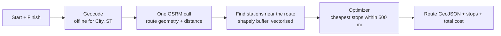

# ⛽ Spotter Fuel Optimizer

A Django REST API that plans a road trip anywhere in the USA and tells you **where to fuel up to spend the least**.

Give it a start and a finish. It returns the driving route, the cheapest fuel stops along the way (never more than 500 miles apart), and the **total fuel cost** for the trip.

---

## ✨ What it does

- 🗺️ **Route + map:** returns the route as GeoJSON and includes a built-in Leaflet map page to see it.
- 💰 **Cost-optimal fuel stops:** picks stops using real fuel prices (6,600+ US truck stops from the provided CSV).
- 🚚 **500-mile range, 10 mpg:** plans as many stops as the trip needs, and never leaves a gap longer than one tank.
- 🧾 **Total fuel cost:** all fuel the trip uses, with a breakdown.
- ⚡ **Fast:** station matching takes a few milliseconds in local tests. A new trip makes **one** call to the routing API, and repeat trips make none.

---

## 🧭 How it works



1. **One-time import** (`import_stations`): the CSV is cleaned (US only, one row per truck stop at its lowest price), city coordinates are attached from an offline city list, and everything is stored in the database. Nothing is geocoded while serving a request.
2. **Geocoding:** `City, ST` inputs are resolved offline. Street addresses use Nominatim, and results are cached.
3. **Routing:** a single OSRM request returns the full route. Results are cached.
4. **Station matching:** the route is buffered with shapely, and every station inside it gets its distance from the road and its **mile marker** along the route.
5. **Optimizer:** at each stop it buys only enough fuel to reach a cheaper station in range; otherwise only enough to finish; otherwise it fills the tank and moves on to the cheapest station in range.

The optimizer is tested against an exact dynamic-programming solver on 300 random routes, and the results match.

---

## 🚀 Quick start

```bash
# 1. Create and activate a virtual environment
python -m venv .venv
.venv\Scripts\Activate.ps1        # Windows PowerShell
# source .venv/bin/activate        # macOS / Linux

# 2. Install dependencies
pip install -r requirements.txt

# 3. Create the database and load the fuel stations (one time, takes seconds)
python manage.py migrate
python manage.py import_stations

# 4. Run the tests and start the server
python manage.py test routing
python manage.py runserver
```

Then open **http://127.0.0.1:8000/**.

| Page | URL |
|---|---|
| Home menu | `http://127.0.0.1:8000/` |
| Route map | `http://127.0.0.1:8000/api/map/` |
| Health check | `http://127.0.0.1:8000/api/health/` |

---

## 📡 API

### `POST /api/route/`

**Request**

```json
{
  "start_location": "New York, NY",
  "finish_location": "Chicago, IL"
}
```

| Field | Required | Notes |
|---|---|---|
| `start_location` | yes | `City, ST`, a street address, or `lat,lng` (USA only) |
| `finish_location` | yes | same formats as above |
| `starting_fuel_gallons` | no | 0 to 50, default 50 (a full tank) |

**Response** (trimmed)

```json
{
  "status": "success",
  "distance_miles": 790.57,
  "duration_minutes": 750.0,
  "map_url": "http://127.0.0.1:8000/api/map/?start=New+York%2C+NY&finish=Chicago%2C+IL",
  "route": { "type": "LineString", "coordinates": [[-74.0, 40.71], "..."] },
  "fuel_stops": [
    {
      "station_name": "SHEETZ #770",
      "city": "London",
      "state": "OH",
      "distance_from_start_miles": 487.91,
      "fuel_price_per_gallon": 2.999,
      "fuel_purchased_gallons": 29.06,
      "fuel_cost": 87.14
    }
  ],
  "total_fuel_cost": 251.09,
  "cost_breakdown": {
    "fuel_bought_at_stops": 87.14,
    "starting_tank_fuel_used": 163.95
  },
  "fuel_used_gallons": 79.06
}
```

> The numbers above are illustrative. Run the request in Postman to see the live result for your trip.

**Errors**

| Status | Meaning |
|---|---|
| 400 | Missing or invalid input, same start and finish, location not found or outside the USA |
| 422 | No fuel station is reachable within 500 miles on part of the route |
| 502 | The routing service (OSRM) is unavailable or found no driving route |
| 503 | The station table is empty. Run `python manage.py import_stations` |

### `GET /api/health/`

Returns `{"status": "success", "message": "Spotter Fuel Optimizer API is running"}`.

---

## 🧪 Try these trips

| Trip | What it shows |
|---|---|
| Atlanta, GA → Nashville, TN | Short trip, no fuel stop needed |
| New York, NY → Chicago, IL | A typical long trip |
| Seattle, WA → Los Angeles, CA | Multiple stops down the coast |
| Billings, MT → Boise, ID | Sparse roads (the search radius widens if needed) |
| New York, NY → Los Angeles, CA | Cross-country, many stops |

To check the live routing and geocoding services and see how many external calls each trip makes:

```bash
python manage.py check_live
```

---

## 🗂️ Project structure

```
config/                     Django settings and root URLs
fuel_data/                  Fuel price CSV and the offline city list
routing/
├── models.py               Station model
├── views.py, urls.py       API endpoints and pages
├── serializers.py          Request validation
├── templates/routing/      Home menu and Leaflet map page
├── management/commands/    import_stations, check_live
├── services/
│   ├── fuel_data_service.py   CSV cleaning and deduplication
│   ├── city_lookup.py         Offline city coordinates
│   ├── geocoding.py           Offline lookup first, Nominatim as fallback
│   ├── route_service.py       OSRM routing call (cached)
│   ├── station_matcher.py     Stations near the route + mile markers
│   ├── fuel_optimizer.py      The fuel-stop algorithm
│   └── trip_planner.py        Ties everything together
└── tests.py                Unit, API and end-to-end tests (no internet needed)
```

---

## 📐 Assumptions and limitations

- **Vehicle:** 500-mile range and 10 mpg, so a 50-gallon tank that starts full.
- **Total cost** covers all the fuel the trip uses: fuel bought at stops plus the starting tank, priced at the first station on the route.
- **Station locations are city-level.** The CSV has highway exits rather than coordinates, so each station is placed at its city's coordinates. "Near the route" means within 10 miles (widened to 25, then 50 miles, only if a stretch has no station).
- **Duplicate truck stop IDs** in the CSV keep their lowest price. Canadian rows are ignored.
- The route in the response is simplified (about 50 m) to keep it small. Station matching uses the full-resolution route.
- **Free public services:** the OSRM demo server and Nominatim are shared, so they can occasionally be slow or rate-limited.
- Settings are for development (`DEBUG = True`). They are not meant for production.

---

## 🛠️ Tech stack

Python 3.14 · Django 6.1 · Django REST Framework · pandas · shapely + pyproj · OSRM (routing) · Nominatim (address geocoding) · Leaflet (map) · SQLite

Offline city coordinates come from [kelvins/US-Cities-Database](https://github.com/kelvins/US-Cities-Database).
